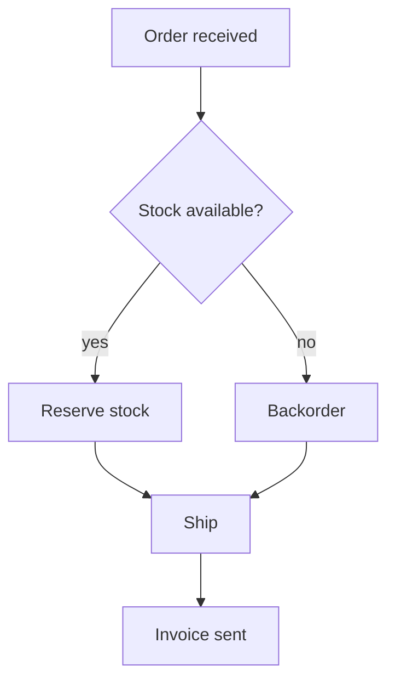

# Diagram Studio

Turn diagram source text into finished artwork: **SVG (vector) + high-res PNG** rendered with Mermaid 11 in a headless browser. `mermaid.min.js` ships inside the skill, so rendering works **offline**. PNGs drop straight into Report Studio (`image.path`) and Deck Builder (`image.path` on an `image` slide); SVGs are ideal for docs and web.

Use this skill for: system architecture, data flow, approval/decision flows, sequence diagrams (API/message flows), state machines, ER diagrams, gantt timelines, org mindmaps, share splits (pie), or any "draw a diagram / flowchart / sequence / ER / timeline" request.

## How it works

```bash
python scripts/doctor.py
python scripts/render.py diagram.mmd --out diagrams
python scripts/render.py diagrams.json --out diagrams
```

Input is either:

- a **Mermaid file** (`.mmd`/`.txt`) — one diagram; name comes from the file stem, or
- a **spec JSON** — batch several diagrams in one run:

```json
{
  "theme": "default",
  "scale": 2,
  "diagrams": [
    { "name": "order-flow", "code": "flowchart TD\n    A[Order] --> B{Paid?}\n    B -- yes --> C[Ship]" },
    { "name": "revenue", "code": "pie title Revenue by region\n    \"North\" : 42\n    \"South\" : 28" }
  ]
}
```

Output per diagram: `<name>.svg` (vector) + `<name>.png` (scale ×2 default). The script prints a JSON summary with paths, pixel sizes and errors. Use `timeoutMs: 300000` on `medusa_runCommand`.

`--theme default|dark|neutral|forest`, `--scale 2`, `--format both|svg|png`, `--out DIR` (default `diagrams`).

## Step 1 — Pick the diagram type

| Goal | Mermaid type |
|---|---|
| Process, decision flow, architecture | `flowchart TD` (or `LR`) |
| API/message interactions, swimlane steps | `sequenceDiagram` |
| Lifecycle / status machine | `stateDiagram-v2` |
| Data model, schema | `erDiagram` |
| Project timeline | `gantt` |
| Share/composition | `pie` |
| Brainstorm / structure | `mindmap` |
| Milestone story | `timeline` |

## Step 2 — Write the source

Keep it readable: 3–12 nodes per flowchart, short labels (≤ 5 words), meaningful edge labels (`-- yes -->`). Examples ship in `examples/`.



### Syntax pitfalls (they cause parse errors)

- Labels with punctuation, brackets or commas **must be quoted**: `A["Q3 (north)"]`.
- Never name a node or subgraph `end` (reserved); use `END` or quote it.
- Flowchart edge text goes after the pipe: `A -- "not now" --> B`.
- In `sequenceDiagram`, use `participant`, `->>` (solid) and `-->>` (dashed) responses; `Note over A,B: text`.
- `pie` labels need quotes when they contain spaces: `"North region" : 42`.
- `gantt` needs `dateFormat YYYY-MM-DD` as the first line.
- Comments start with `%%`.

## Step 3 — Render and verify

1. Run `render.py`. **Read the summary JSON**: `ok: true` per diagram, plus pixel `width/height`.
2. If a diagram errors, the message includes the Mermaid parse error (with line number) — fix the source and re-render just that one.
3. Sanity-check dimensions: tiny (< 200 px wide) usually means an empty or trivial diagram; enormous (≫ 4000 px) means the graph is too dense — split it.
4. When embedding: use the **PNG** in Deck Builder (`image.path`) or Report Studio (`image` with `caption`); use the **SVG** in docs/web.

## Step 4 — Deliver

Report the absolute paths (svg + png), the diagram type, and one line on what it shows. Offer follow-ups: embed into a Report Studio PDF or Deck Builder slide, or iterate on the diagram.

## Troubleshooting

- **"mermaid.min.js not found"** → run from the skill folder (the `vendor/` directory must be present), or re-install the skill.
- **Playwright/Chromium error** → `python -m playwright install chromium`.
- **Parse error** → apply the pitfalls above; quote all labels with special characters.
- **PNG blurry in slides** → re-render with `--scale 3`.
- **Browser-only MEDUSA** → Python cannot run; ask the user to use the desktop app.

## Files

- `scripts/render.py` — CLI orchestrator
- `scripts/mermaid_renderer.py` — HTML page + Playwright renderer (SVG text + PNG screenshot)
- `scripts/doctor.py` — checks Playwright/Chromium and the bundled Mermaid
- `vendor/mermaid.min.js` — Mermaid 11.17.2 (bundled, offline)
- `examples/flowchart.mmd`, `examples/diagrams.json` — runnable demos
